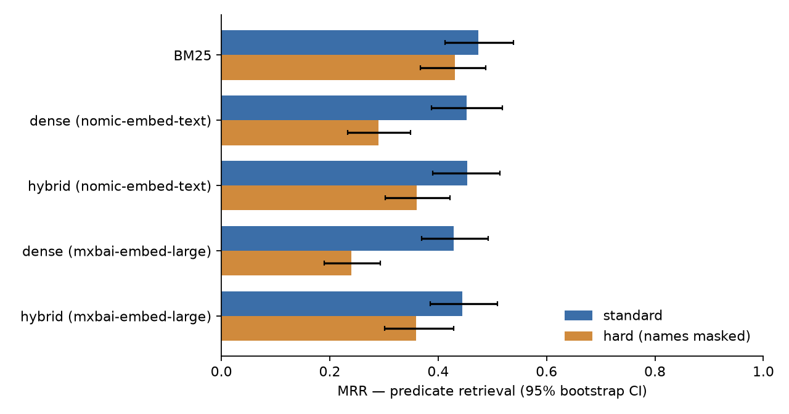

# orthorag

**Retrieval-augmented drafting of FDA 510(k) summaries for orthopedic implants: built on public data, run on local models, and evaluated against labels written by regulatory experts.**

Before an implant goes on the U.S. market, its manufacturer writes a *510(k) summary*. The summary argues that the new device is substantially equivalent to devices that are already cleared, called *predicate devices*. Regulatory engineers spend hours reading earlier summaries to find comparable devices and reuse their structure.
orthorag does both steps on a laptop with no API costs. It **retrieves** the most similar cleared devices for a new device description, then **drafts** the summary sections with a citation on every claim.



## Highlights

- **Corpus:** 289 public 510(k) summaries for orthopedic bone plates and screws (FDA product codes HRS and HWC), collected through openFDA. 2,813 section-aware chunks.
- **Evaluation without manual labels.** Every summary cites its predicate devices, so the corpus contains its own relevance labels. The [benchmark](#evaluation-predicate-retrieval) asks each system to find a device's predicates from its description alone. It covers 150 queries, with bootstrap confidence intervals.
- **Hybrid retrieval:** BM25, dense embeddings (nomic-embed-text, mxbai-embed-large) and Reciprocal Rank Fusion. Dense search uses ChromaDB.
- **Grounded generation:** a local LLM (Llama 3.2 3B via Ollama) drafts each section. Every citation is checked automatically against the sources that were actually retrieved.
- **Fully local and reproducible:** one command per stage, with unit tests.

## How it works

```
openFDA API ──► 510(k) PDFs ──► parse ──► sections + cited predicates
                                              │
                         section-aware chunks (contextual headers)
                                 │                    │
                              BM25            ChromaDB (2 embedding models)
                                 └──── RRF fusion ────┘
                                          │
         new device description ──► top-k sources ──► Llama 3.2 3B ──► draft + citation check
```

| Stage | Module | Notes |
|---|---|---|
| Fetch | `fetch.py` | The 150 most recent summaries since 2018. A second pass adds the predicates they cite, so the benchmark labels exist in the corpus. |
| Parse | `parse.py` | Strips the FDA clearance letter and splits the text into canonical sections (description, indications, predicates, technology, performance). Extracts the cited K-numbers. |
| Chunk | `chunking.py` | Splits each section separately into chunks of about 900 characters. Each chunk starts with a `device — section` header. |
| Index | `index.py`, `embed.py` | Uses the prefixes each embedding model was trained with (`search_query:` / `search_document:`). |
| Retrieve | `index.py` | `bm25`, `dense` or `hybrid` (RRF, k=60). |
| Generate | `generate.py` | Retrieves sources separately for each section. Every claim must be cited, and `[TO VERIFY]` replaces unsupported content. |
| Evaluate | `evaluate.py` | Recall@k, MRR, nDCG@10, with a bootstrap 95% CI. |

## Evaluation: predicate retrieval

- **Query:** the *device description* and *indications for use* of a summary. All K-numbers are masked, and the predicate section is never used.
- **Relevant documents:** the devices that summary cites, when they are present in the corpus.
- **Corpus:** every other summary. The query document itself is excluded.
- **Two settings.** *standard* keeps the query text as written. *hard* also masks the brand and manufacturer names. Predicates are often earlier versions of the same product line, so brand names make the task easy; the hard setting forces matching on technical content.

150 queries per setting, 289 documents:

| Setting | System | Recall@5 | Recall@10 | MRR [95% CI] | nDCG@10 |
|---|---|---|---|---|---|
| standard | **BM25** | **0.462** | 0.556 | **0.475** [0.41–0.54] | 0.426 |
| standard | dense (nomic) | 0.407 | 0.500 | 0.452 [0.39–0.52] | 0.402 |
| standard | hybrid (nomic) | 0.426 | **0.578** | 0.454 [0.39–0.51] | **0.427** |
| standard | dense (mxbai) | 0.414 | 0.495 | 0.429 [0.37–0.49] | 0.387 |
| standard | hybrid (mxbai) | 0.412 | 0.524 | 0.444 [0.39–0.51] | 0.400 |
| hard | **BM25** | **0.365** | **0.441** | **0.431** [0.37–0.49] | **0.357** |
| hard | dense (nomic) | 0.246 | 0.302 | 0.290 [0.23–0.35] | 0.228 |
| hard | hybrid (nomic) | 0.329 | 0.423 | 0.360 [0.30–0.42] | 0.307 |
| hard | dense (mxbai) | 0.196 | 0.280 | 0.240 [0.19–0.29] | 0.195 |
| hard | hybrid (mxbai) | 0.316 | 0.414 | 0.359 [0.30–0.43] | 0.303 |

**What the numbers say**

1. **Lexical search is a strong baseline in this domain.** Regulatory text is dense in exact identifiers: material standards (ASTM F136), alloys (Ti-6Al-4V), anatomy (distal radius, clavicle), screw diameters. BM25 matches them exactly. General-purpose embedding models blur them.
2. **Dense retrieval depends heavily on brand names.** When names are masked, dense MRR drops by 36% (nomic) and 44% (mxbai). BM25 drops by only 9%.
3. **Plain RRF helps dense search but does not beat BM25.** Equal-weight fusion mixes in a weaker ranker. The likely next steps are a weighted fusion tuned on a validation split, a cross-encoder reranker, or embeddings fine-tuned on (device, predicate) pairs, for which this benchmark directly provides training data.

Results: [`results/retrieval_benchmark.md`](results/retrieval_benchmark.md) · per-query results: [`results/retrieval_per_query.csv`](results/retrieval_per_query.csv)

## Example draft

Input ([`examples/clavicle_plate.txt`](examples/clavicle_plate.txt)): a description of a hypothetical titanium clavicle plating system. The full output for the three sections, generated in about 60 seconds on a laptop with 8 GB of RAM, is in [`results/example_draft.md`](results/example_draft.md).

> *Material: The XYZ Clavicle Plating System is made from titanium alloy (Ti-6Al-4V, ASTM F136), similar to the SIGNEX Narrow and Broad LCP Plates [K243469] and the Bonebridge Osteosynthesis Plating System [K243308]. In contrast, the OsteoCentric Bone Plate and Screw System [K250494] is fabricated from medical grade stainless steel…*

Every citation in the example points to a retrieved source. The citation check passes, but it does not prove faithfulness. See the limitations below.

## Quickstart

Requirements: Python 3.10–3.12 and [Ollama](https://ollama.com).

```bash
pip install -e ".[dev]"
ollama pull llama3.2:3b && ollama pull nomic-embed-text && ollama pull mxbai-embed-large

orthorag fetch          # ~290 public PDFs (~240 MB) into data/raw
orthorag parse && orthorag index
orthorag evaluate       # reproduces the table above
orthorag draft @examples/clavicle_plate.txt
streamlit run app.py    # interactive demo
pytest                  # unit tests (no network or models needed)
```

## Limitations and next steps

- **Valid citations do not prove faithful content.** The 3B model sometimes attaches a citation to a fact that came from the user's own description. It also writes plausible but unsupported claims, for example "results meet or exceed the requirements". Next step: claim-level faithfulness scoring (NLI or an LLM judge) and a stricter extractive prompting mode.
- **The labels are noisy.** Cited K-numbers include *reference* devices as well as primary predicates, and some relevant devices are never cited. Absolute scores are therefore pessimistic; comparisons between systems remain valid.
- **The corpus is small:** two product codes and 289 documents. Scaling to all orthopedic product codes would test whether the gap between BM25 and dense retrieval persists.
- **Parsing is heuristic.** About 30% of summaries have no detected *device description* heading, because headings vary widely between manufacturers. Their content is still indexed under the sections that were detected, or as whole-text chunks. A layout-aware parser would improve both chunking and query building.

## Data and disclaimer

All documents are public U.S. government records retrieved from [openFDA](https://open.fda.gov) and accessdata.fda.gov. They are not committed to this repository; `orthorag fetch` downloads them. This is a research and educational project, not a regulatory tool. Drafts must be reviewed by qualified regulatory professionals.

## License

MIT
